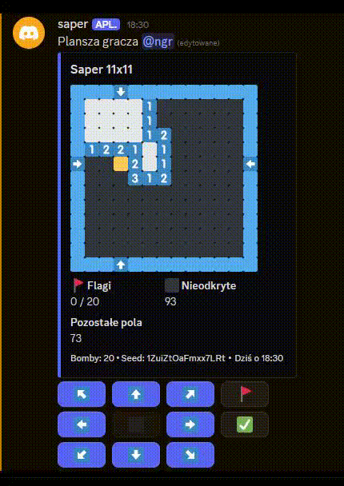

# Saper - bot na Discorda

Bot do gry w klasycznego sapera bezpośrednio na Discordzie. Zamiast wpisywać współrzędne w komendach, odkrywasz pola, klikając przyciski pod wiadomością z planszą.



## Funkcje

- **Plansze na forum:** po zakończeniu post dostaje tag z wynikiem, a potem jest archiwizowany i zamykany.
- **Własne plansze:** wybierasz wymiary, liczbę bomb i seed.
- **Wyzwania:** tworzysz planszę dla innego użytkownika.
- **Gry rankingowe:** plansza 11x11 z 20 bombami.
- **Ranking:** osobny dla każdego serwera, liczony z gier rankingowych.

## Jak grać

| Komenda          | Co robi                                                                      |
| ---------------- | ---------------------------------------------------------------------------- |
| `/game create`   | Nowa plansza (opcje: `rows`, `cols`, `bombs`, `seed`, `ranked`, `challenge`) |
| `/game cancel`   | Poddaje Twoje aktywne gry                                                    |
| `/ladder top`    | Top 10 graczy na serwerze                                                    |
| `/ladder player` | Statystyki wybranego gracza                                                  |
| `/help`          | Opis planszy i przycisków                                                    |

Strzałkami przesuwasz kursor, ✅ odkrywa pole, a 🚩 stawia lub zdejmuje flagę. Pole w lewym górnym rogu zawsze jest bezpieczne.

## Setup

Wymagania: Node.js 24.17+ i pnpm.

1. Skopiuj ID oraz token bota z [Discord Developer Portal](https://discord.com/developers/applications).
2. Utwórz plik `.env.local`:

   ```sh
   CLIENT_ID=        # ID aplikacji
   CLIENT_SECRET=    # token bota
   GAME_SECRET=      # dowolny długi losowy ciąg, szyfruje seedy gier rankingowych
   GAME_FORUM_NAME=  # nazwa kanału-forum na gry, np. saper
   DEV_GUILD_ID=     # opcjonalne: komendy rejestrują się tylko na tym serwerze
   ```

3. Zainstaluj pakiety, zarejestruj komendy i uruchom bota:

   ```sh
   pnpm install
   pnpm register-commands
   pnpm dev
   ```

4. Dodaj bota na serwer linkiem
   `https://discord.com/oauth2/authorize?client_id=<CLIENT_ID>&scope=bot+applications.commands`
   i utwórz forum o nazwie `GAME_FORUM_NAME`. Na tym forum bot potrzebuje uprawnień **Tworzenie postów**, **Zarządzanie wątkami** i **Zarządzanie kanałem**.
